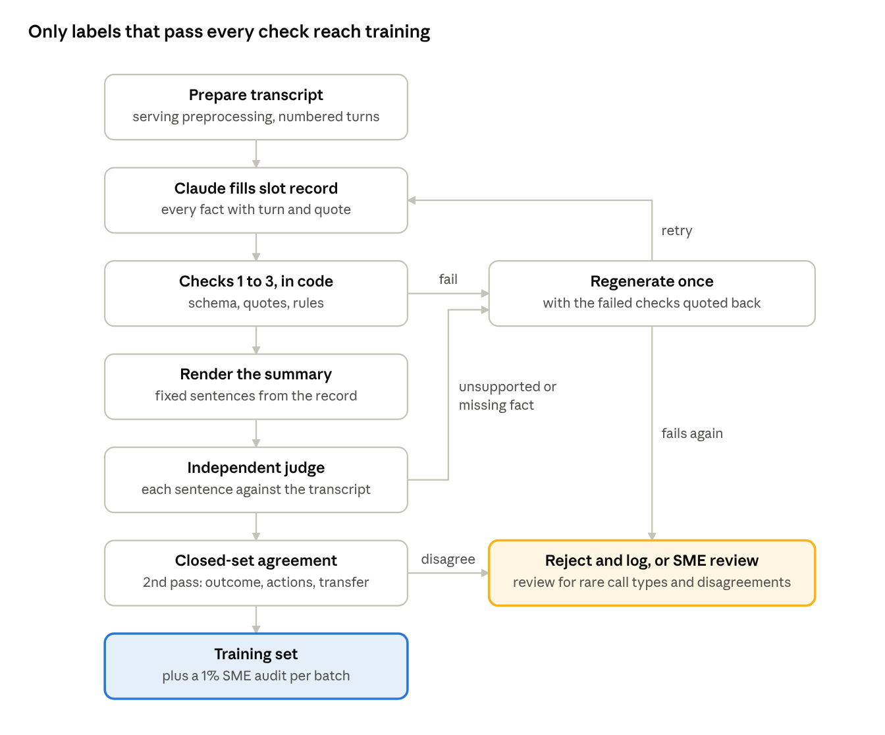

# Ground Truth Generation Design: Low-Hallucination Call Summaries

Oct 28, 2026 · @Swetha

_Exported from the [live doc](https://claude.ai/artifact/5768iTMWsF25Z7DFVxkFFe) on 2026-10-28; the live doc is the source of truth._

## Goal and principles

The next summarization model will be trained on new labels: summaries in which **every sentence is supported by the transcript**. The current labels are agent notes, and many contain facts the call never mentions. The model learns to invent those facts. Model choice comes later; this document covers only how the labels are made.

### Why the current model hallucinates

Each cause below traces to the data or the code, not to the model architecture.

| Cause | Evidence | Effect on the model |
| --- | --- | --- |
| Labels contain facts not in the call | Domestic-violence call: label says "ex-partner", "under weight"; the ASR transcript is mostly unreadable | Learns to write plausible detail with no source |
| Labels contain agent actions taken after the call | "An email was sent to PRS", "called device registration" with no trace in the transcript | Learns to append actions by default |
| Preprocessing changes meaning | Duplicate `HCP` key in `mappings` turns "healthcare provider" into "healthcare plan" | Writes "managing healthcare plan was Dr. Cooper" |
| Short and incomplete calls are removed | `align_calls` drops every call under 538 words | Never learned what to write when little happens, so it fills in a full template |
| Formula sentences are over-represented | "The patient was redirected to their healthcare provider" appears even when the agent never said it | Adds the sentence on calls where it is false |
| Forced length | `minlen` = 5% of input tokens at inference | Pushes the model to keep writing after the facts run out |

### Design principles

1. **Grounded or absent.** A fact goes in only if the transcript states it. When the transcript doesn't say, the summary says nothing, or uses a fixed "not stated" form.
2. **Evidence first, prose second.** The labeller extracts facts with quoted transcript lines. A script then writes the prose from those facts, so no free-writing step can add anything.
3. **Closed wording where the content is a closed set.** Caller type, outcome, actions and transfer use fixed sentences. They can be checked by string match, and the model learns them exactly.
4. **Checked by independent means.** Deterministic code checks, a quote check and a judge model that did not write the label. Each catches errors the others miss.
5. **Reject rather than repair.** A label that fails a check is regenerated or dropped, never patched by hand in bulk. A smaller clean set beats a larger noisy one.
6. **Same input as production.** The labeller sees exactly the text the service will feed the model.

## Scope and data window

Label calls from **2024-07-01 to 2026-09-30**. Train and validate on the first 24 months; keep the last quarter as a time-based test set that no model or prompt is tuned on.

| Split | Window | Use | Expected size |
| --- | --- | --- | --- |
| Train | 2024-07-01 to 2026-06-30, about 90% | Model training | About 27k calls (open question: confirm monthly volume) |
| Validation | Same window, about 10%, grouped by patient | Checkpoint choice, prompt checks | About 3k calls |
| Test | 2026-07-01 to 2026-09-30 | Final scoring only | All calls in the quarter |
| Gold | 500 calls sampled from Test | Human-verified reference | 500 |
| Prompt dev | 300 calls from Train, frozen | Prompt iteration and judge calibration | 300 |

The Jul 2024 to Feb 2025 overlap with the old dataset lets us compare old and new labels on the same calls.

### Which calls are included

Every call type is labelled, because the model must learn the right output for each one.

| Call type | Old pipeline | New pipeline |
| --- | --- | --- |
| Normal call, one issue | Kept | Kept |
| Several issues in one call | Kept, notes merged by hand | Kept, one block per issue |
| Transferred out before a reason is given | Dropped (under 538 words) | Kept, fixed transfer sentence |
| Transferred out after partial information | Dropped or kept by chance | Kept, slots plus transfer sentence |
| Transferred in by a third party | Kept | Kept, not treated as a transfer out |
| Cut off or incomplete | Dropped | Kept, fixed incomplete sentence |
| Under 26 words after cleaning | Dropped | Excluded; the service returns "Empty Call" |
| Empty transcript with a note | Kept if not NaN | Dropped |
| Unreadable ASR (most turns garbled) | Kept | Labelled from what is readable; flagged for review if under half is readable |

Transfer and incomplete calls are kept at their natural rate in Test. In Train they may be oversampled up to about 10% each if they are rarer than that.

## Input preparation

The labeller sees the same cleaned transcript the service gives the model, with each turn numbered so every fact can point to its source line.

1. **Run the serving preprocessing.** Use `aggregate_by_channel` and `clean_transcript` from `src/preprocess/process_transcripts.py`, imported, not copied. If the model input and the label input differ, the model is trained to state facts it cannot see.
2. **Keep the turns.** After cleaning, split back into `Agent:` and `Caller:` turns and number them `[T1]`, `[T2]` and so on. The model input later drops the numbers; the text is otherwise identical.
3. **Do not rewrite the transcript.** No abbreviation expansion, no `he/she` replacement, no number conversion. Those steps change what was said. Conversions of spelled-out IDs happen in the label, with the source turn cited.
4. **Record metadata, never show it as fact.** Call date, call codes and the old agent note are stored beside the call. The note may be shown to the labeller only as a hint (section 5), never as a source.

### Fixes required in the existing preprocessing (`mdt_scripts`)

These affect the old labels and the comparison against them. None of these steps run on the new labels.

| Fix | Where | Why |
| --- | --- | --- |
| Remove the duplicate `HCP` key | `mappings` | "healthcare plan" replaces "healthcare provider" |
| Remove the `POR` and `ERI` round-trip entries | `mappings` | Expansions undo each other depending on order |
| Stop lowercasing device serials | `lowerNotes`, `process_notes` | `NLD107917N` becomes `nld107917n` |
| Drop rows with blank transcripts | `main.py` | `dropna` misses whitespace-only cells |
| Rename `min_ratio` / `max_ratio` | `align_calls` | Names are the wrong way round |
| Remove the 538-word floor | `align_calls` | Needed for short and transfer calls |

## Summary specification

Every summary is built from the same eight slots, in the same order, with fixed sentences wherever the content is a closed set. This is the template your agents already use, made strict.

### Slots

| # | Slot | Type | Rendered as |
| --- | --- | --- | --- |
| 1 | Caller type, device type | Closed set | "Information was received from a {caller} regarding {device}." |
| 2 | Device IDs | List of model + serial | "{Device name} ({model}) s/n {SERIAL}." Left out when none were read on the call |
| 3 | Reason for call | Free text, cited | "The reason for call was {reason}." |
| 4 | Onset and circumstances | Free text, cited, optional | "Caller said the issue started {onset}." "When asked, caller said {circumstance}." Or the fixed sentence below |
| 5 | Troubleshooting | Ordered steps, cited | "Agent walked {caller} through {step}. {Caller} confirmed {result}." |
| 6 | Outcome | Closed set | One fixed sentence (below) |
| 7 | Actions and disposition | Closed set, may repeat | One fixed sentence each (below) |
| 8 | Other statements | Free text, cited, optional | "{Caller} mentioned {statement}." |

A call with two issues repeats slots 1 to 7 per issue, then slot 8 once at the end.

### Closed sets

| Slot | Allowed values and their exact sentence |
| --- | --- |
| Caller | patient · patient's representative · healthcare provider · manufacturer's representative · third party |
| Device | an external device · an implantable neurostimulator · an implantable neurostimulator and an external device |
| Circumstances not asked | "Agent did not ask about the circumstances that led to the reported issue." |
| Outcome: resolved | "The troubleshooting steps that were taken on the call resolved the issue." |
| Outcome: not resolved | "The issue was not resolved through troubleshooting." |
| Outcome: not possible | "Troubleshooting was unable to be performed because {reason}." |
| Outcome: none needed | "No troubleshooting was required." (questions, information requests) |
| Action: replacement | "An email was sent to the repair department to replace the {device part}." |
| Action: redirected | "The patient was redirected to their healthcare provider to further address the issue." |
| Action: rep informed | "Agent sent an email to the Medtronic representative for visibility." |
| Action: call back | "{Caller} will call back {condition}." |
| Action: record update | "Agent updated the patient's {field}." |
| Transfer out, no reason given | "The caller was transferred to another team for assistance." (whole summary = slot 1 + this) |
| Transfer out, after partial info | "The caller was transferred to {team} for further assistance." (replaces the outcome) |
| Transfer in | "The call was transferred in from {party}." (slot 1, then normal template) |
| Incomplete | "This call was not completed to get all the information as needed." (whole summary) |

### Hard rules

- **Only what was said.** No fact, number, name, date or action that is not in the transcript.
- **An action needs the agent's words.** "Redirected", "email sent", "replacement" and "transfer" are written only when the agent says them on the call. A plan to do it later ("I'll get that request in") counts; a guess from the call type does not.
- **IDs exactly as read.** Spelled-out IDs are converted ("n l d one zero seven nine one seven n as in nancy" → `NLD107917N`), uppercase, with the source turn cited. An ID that is only partly audible is left out, not completed.
- **Unclear means absent.** Garbled or ambiguous turns are not summarized. Never infer what the caller probably meant.
- **No personal identifiers.** No patient name, date of birth, phone or address. Doctor names are kept.
- **Neutral wording.** "The patient", "the caller", "they". No judgement of the caller.
- **No length target.** The summary is as long as the facts. A short call gets a short summary.

### Example (call 2 from the sample)

```markdown
Information was received from a patient regarding an external device. Controller (97745) s/n NLD107917N. Recharger (97755) s/n NLF137598N. The reason for call was that the patient could not charge their implanted neurostimulator properly; when the equipment connected it took a long time to reach Recharging Excellent and the connection did not last. Caller said the issue started at least four or five months ago. Agent walked the patient through removing the battery pack and restarting the controller. Patient confirmed there were no issues charging the controller from the AC power supply and saw no damage to the recharger. Patient confirmed the controller was at 80% and the implanted neurostimulator at 40%. Agent walked the patient through starting a recharging session; patient saw Recharging Excellent with the green light flashing. The issue was not resolved through troubleshooting. An email was sent to the repair department to replace the recharger. Patient mentioned they had texted their representative, Jeff, on Monday without a response. Agent advised contacting the representative through their doctor's office.
```

Compared with the old label: "redirected patient to healthcare plan" is gone, because the agent pointed to the doctor's office for the representative, not for the device issue. The serials are uppercase.

## Generation step

Claude does not write the summary. It fills a JSON record in which every free-text fact carries the turn number and a verbatim quote it came from. A script turns the record into the summary.

### Model and settings

| Setting | Choice | Reason |
| --- | --- | --- |
| Labeller | `claude-opus-5-5` (pilot against `claude-sonnet-5-5`) | Labels set the ceiling for the student model; pick on measured quality |
| Effort | `high` (pilot `medium` too) | Long, noisy transcripts reward careful reading |
| Platform | Amazon Bedrock, batch inference | PHI stays in your AWS account; batch halves the price |
| Output | JSON matching the schema below | Validated by code before anything else runs |
| Caching | System prompt (spec + examples) cached | Same for every call; most input tokens become cache reads |

The judge model in section 6 is a different model from the labeller, so the same blind spots don't pass twice.

### Record schema

```json
{
  "call_status": "complete | incomplete | transfer_out_before_reason",
  "transferred_in_from": null,
  "caller_type": "patient | patients_representative | healthcare_provider | manufacturers_representative | third_party",
  "issues": [
    {
      "device_type": "external | implant | implant_and_external",
      "device_ids": [{"name": "Controller", "model": "97745", "serial": "NLD107917N", "turns": ["T24", "T25"], "quote": "n l d one zero seven nine"}],
      "reason": {"text": "...", "turns": ["T8"], "quote": "..."},
      "onset": {"text": "...", "turns": ["T16"], "quote": "..."},
      "circumstances": {"asked": true, "text": "...", "turns": [], "quote": "..."},
      "troubleshooting": [{"step": "...", "result": "...", "turns": [], "quote": "..."}],
      "outcome": "resolved | not_resolved | not_possible | none_needed | transferred_out",
      "outcome_reason": null,
      "transfer_team": null,
      "actions": [{"type": "replacement | redirected_hcp | rep_informed | call_back | record_update", "detail": "...", "turns": [], "quote": "<the agent's words>"}]
    }
  ],
  "other_statements": [{"text": "...", "turns": [], "quote": "..."}],
  "unreadable_share": "low | medium | high",
  "labeller_notes": "anything uncertain, for the reviewer"
}
```

Every optional field is `null` or empty when the transcript doesn't state it. An empty field is a correct answer, not a failure.

### Prompt design

- **System prompt (cached):** the spec from section 4, the schema, and 8 worked examples taken from the prompt-dev set and approved by SMEs. The examples must cover a normal call, two issues, a transfer out before the reason, a transfer out after partial info, a transfer in, an incomplete call, a mostly garbled call and a call where the agent did **not** redirect.
- **User turn:** the numbered transcript only.
- **Instructions that matter most:** quote, don't paraphrase, in `quote`; leave a field empty rather than guess; actions need the agent's words; list doubts in `labeller_notes`.
- **Old agent note as a hint:** tested in the pilot as arm B. If used, it goes in a separate block marked "may be wrong or incomplete; include a fact only if you can quote the transcript for it". Keep it only if it raises coverage without raising the unsupported-fact rate.

### Rendering

A Python script fills the section 4 templates from the record. It writes the fixed sentences itself, uppercases IDs, removes duplicate sentences and never adds text the record doesn't hold. The rendered summary and the record are both stored; the record is used only for checking and review and is never shown to the student model.

## Verification layers

Each label passes five checks in order, from cheap and certain to expensive and judgement-based. A label enters the training set only if it passes all of them.



A failure at any check gets one regeneration; a second failure is rejected and logged, or sent to SME review for rare call types.

| # | Check | How | Catches |
| --- | --- | --- | --- |
| 1 | Schema | Code: JSON validates; closed-set fields hold allowed values | Malformed output, invented categories |
| 2 | Quotes | Code: each `quote` matches its cited turns after normalisation (lowercase, punctuation removed, at least 90% token overlap). Each serial must be rebuilt from the cited turns' spelled letters and numbers | Paraphrased or invented evidence, completed or guessed IDs |
| 3 | Rules | Code: action and transfer quotes come from `Agent:` turns; a transfer quote contains a transfer phrase; resolved + replacement together are flagged; no phone, date-of-birth or address patterns in the summary; no banned strings ("healthcare plan"); no repeated sentences | Default actions, false transfers, PII, known artifacts |
| 4 | Independent judge | A second model reads the transcript and the **rendered summary only** (not the record). For each sentence: supported, unsupported or contradicted, with the turn. Then lists missing key facts: reason, outcome, actions, transfer | Unsupported facts the quotes didn't expose; important omissions |
| 5 | Closed-set agreement | A second, cheaper labelling pass fills only caller, outcome, actions and transfer. Disagreement sends the call to review | Wrong outcome or action, the errors that matter most downstream |

### Retry and reject policy

- **Fails 1, 2 or 3:** regenerate once, with the failed checks quoted back to the labeller. Fails again: reject.
- **Judge finds an unsupported or contradicted sentence:** regenerate once with the judge's findings. Still found: send to human review if the call is in a rare type (transfer, incomplete, multi-issue), otherwise reject.
- **Judge finds a missing key fact:** regenerate once. Still missing: keep the label but mark it `incomplete_coverage`; it is excluded from the gold set.
- **Closed-set disagreement:** human review queue.

Rejected calls are logged with the reason, never silently dropped.

### Watch the reject rate by call type

If garbled or transfer calls are rejected far more often than normal calls, the training set loses exactly the cases the model hallucinates on. Report the reject rate per call type after every batch. Above 15% for any type, fix the prompt or route that type to human review instead of dropping it.

### Calibrating the judge

The judge is only trusted after it agrees with SMEs. On the 300-call prompt-dev set, SMEs mark each sentence supported or not. The judge must catch at least 90% of the unsupported sentences SMEs found, with no more than 10% false alarms. Until it does, tune the judge prompt, not the labeller.

## Human review

SMEs check labels at four points: when the prompt is being built, before the full run, to build the gold set, and as a running audit. Each review uses the same form, so results are comparable over time.

### Review form (per call)

| Field | Values |
| --- | --- |
| Unsupported sentences | Count, with the sentence marked |
| Contradicted sentences | Count, with the sentence marked |
| Missing key fact | none · reason · outcome · action · transfer · device ID |
| Closed-set fields correct | caller · outcome · actions · transfer, each yes/no |
| Device IDs correct | yes · no · not on call |
| Overall | accept · accept with edits · reject |
| Corrected summary | Only for the gold set |

Reviewers read the transcript first and the summary second, so the summary doesn't frame what they hear.

### Review stages

| Stage | Calls | Reviewers | Output |
| --- | --- | --- | --- |
| Calibration | 50 from prompt dev | All SMEs, the same calls | Agreement rate; spec clarified where SMEs disagree |
| Pilot | 200 from Train, stratified by call type | 2 SMEs, 20% overlap | Choice of labeller model, effort and hint arm |
| Gold set | 500 from Test, stratified | 2 SMEs each, disagreements settled by a third | Corrected reference summaries for scoring |
| Audit | 1% of every batch, at least 50 | 1 SME | Ongoing error rate; stop the run if it drifts |

**Stratify** means each call type in section 2 gets at least 30 calls in the pilot and 40 in the gold set, even if it is rare.

### Inter-reviewer agreement

On overlapping calls, reviewers must agree on "unsupported sentence present: yes or no" for at least 85% of calls. Below that, the spec is ambiguous: fix the wording in section 4 and recalibrate before labelling more.

## Acceptance metrics

The label set is released for training only when the SME-reviewed sample meets every gate below. The targets are proposals; the pilot shows what is reachable, and the team confirms them before the full run.

| Metric | Measured on | Gate |
| --- | --- | --- |
| Calls with any unsupported or contradicted sentence | Pilot, then audit | ≤ 2% |
| Unsupported sentences, share of all sentences | Pilot, then audit | ≤ 0.5% |
| Actions stated but not said by the agent | Pilot, then audit | 0 in the pilot sample |
| Transfer sentence correct (precision and recall) | Transfer calls in pilot | ≥ 95% each |
| Outcome correct | Pilot | ≥ 95% |
| Device IDs exactly correct, when read on the call | Pilot | ≥ 97% |
| Missing key fact | Pilot | ≤ 5% of calls |
| SME accept or accept with edits | Pilot | ≥ 90% |
| Reject rate, any call type | Full run | ≤ 15% |

Each metric is also run on the **old labels** for the same calls. That gives the baseline and shows how much of the current model's hallucination comes from the labels.

The same metrics, scored against the gold set, later decide which student model ships.

## Compliance, infrastructure and cost

The whole pipeline runs inside your AWS account; transcripts never leave it except to Bedrock in the same account.

### Compliance

- Confirm with compliance that Bedrock is covered by your AWS BAA for this data, and which region to use. Check that the chosen Claude models are offered there.
- S3 buckets encrypted with KMS, access limited to the labelling role. Logs hold call IDs and check results only, never transcript text.
- SME reviewers work in a tool hosted in the same account (for example self-hosted Label Studio), not in spreadsheets sent by email.

### Pipeline components

| Step | Component | Output |
| --- | --- | --- |
| Extract | Query or export by date window | Raw calls in S3 |
| Prepare | Python job using the service's preprocessing | Numbered transcripts, JSONL |
| Label | Bedrock batch inference job | Records, JSONL |
| Check | Python job: checks 1 to 3, render, queue judge and closed-set passes | Pass, retry or reject per call |
| Judge | Bedrock batch inference job | Sentence verdicts |
| Review | Review tool | SME verdicts, gold summaries |
| Publish | Versioned dataset in S3 | Train, validation, test, gold, plus a manifest |

The manifest records the prompt version, model ID, schema version, check thresholds and counts per call type. Any label can be traced back to the exact prompt that made it.

### Cost estimate

Rough figures at Anthropic list prices; Bedrock prices differ, and the pilot measures real token counts.

| Item | Assumption per call | Approx. cost per call |
| --- | --- | --- |
| Labeller, Opus 5.5 | 4k transcript tokens in, 15k cached prompt, 3.5k out including thinking | $0.09 |
| Retries | 30% of calls regenerated once | $0.03 |
| Judge, Sonnet 5.5 | 5k in, 1k out | $0.02 |
| Closed-set pass, Sonnet 5.5 | 4k in, 0.5k out | $0.015 |
| **Total** |  | **about $0.15** |

For about 35k calls that is roughly $5,000, or about $2,500 with batch pricing. The SME review time is likely the larger cost: about 1,000 calls at 5 to 10 minutes each.

## Rollout and open decisions

Work runs in five phases, and each ends at a gate. No phase starts before the previous gate passes.

1. **Spec and tooling.** Freeze the section 4 spec with SMEs, fix the preprocessing, build the prepare, check and render scripts, and pick the 300 prompt-dev calls. *Gate: SMEs sign off the spec and 8 worked examples.*
2. **Prompt and judge calibration.** Iterate the labeller prompt on prompt dev; calibrate the judge against SME sentence marks. *Gate: judge catches ≥ 90% of SME-found unsupported sentences.*
3. **Pilot.** 200 stratified calls, labeller Opus 5.5 vs Sonnet 5.5, effort high vs medium, hint vs no hint. *Gate: one configuration meets every section 8 target.*
4. **Full run.** Label the window in batches of about 5,000, with the audit sample from each batch reviewed before the next starts. *Gate: audit error rate stays within targets; reject rate ≤ 15% per call type.*
5. **Gold set and release.** 500 double-reviewed Test calls; publish the versioned dataset and manifest. *Gate: inter-reviewer agreement ≥ 85%.*

### Open decisions

- [ ] Compliance approval for sending unmasked transcripts to the GPT provider
- [ ] Monthly call volume from Jul 2024 onward, to confirm the window is large enough
- [ ] Multi-issue calls: repeat the full opening per issue, as agents do now, or one opening with numbered issues? Does anything downstream parse summaries?
- [ ] Transfer sentence: name the team ("technical services") or always "another team"?
- [ ] "Agent did not ask about the circumstances": keep it as a required sentence or drop it?
- [ ] Which SMEs review, and how many hours a week they can give
- [ ] Final acceptance targets in section 8
