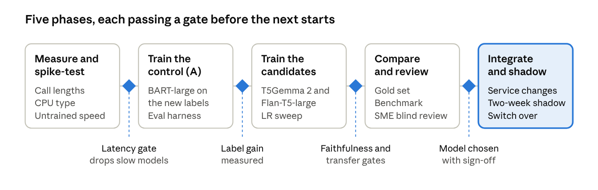

# Summarization Model Selection and Training Plan

Oct 28, 2026 · @Swetha

_Exported from the [live doc](https://claude.ai/artifact/VrSjCNc1Whhonu5ggsAAYm) on 2026-10-28; the live doc is the source of truth._

## Summary

The model we expect to handle almost every call is **T5Gemma 2 270M-270M**: short calls and long ones, every call type, within p50 10 s on 7 vCPU and 14 GB. It reads up to 128K tokens, so long calls no longer need to be split into windows, and it runs on CPU with int8 CTranslate2.

- **Primary:** T5Gemma 2 270M-270M, retrained on the new ground-truth labels.
- **Fallback:** Flan-T5-large, used if T5Gemma 2 fails a gate or its licence does not clear legal review.
- **Baseline:** BART-large retrained on the same labels. It shows how much the labels alone improve accuracy, and it is the floor every other model must beat.
- **Not compared:** models that suit only some calls, such as PEGASUS-X (long calls only) and Qwen3-0.6B (too slow on long calls).
- **Comparison:** all three are scored on the same held-out quarter with the checks from the ground-truth pipeline. One model ships and serves all traffic.
- **Training and serving:** Hugging Face Transformers on one GPU replaces fairseq; serving is int8 on CPU with 7 threads.

The decision this doc asks for is to approve the primary, the fallback, and the gates in How we compare results.

## Constraints and what they rule out

Compute, not memory, is the binding limit: 7 vCPU with no GPU allows a model of about 1B parameters at most, and 14 GB would hold far more.

| Limit | Value | Effect on the choice |
| --- | --- | --- |
| Latency | p50 ≤ 10 s per call | Sets the model size and the decoding settings |
| CPU | 7 vCPU, no GPU | Every output token reads all decoder weights; this is the bottleneck |
| Memory | 14 GB for loading and running | int8 weights of a 1B model take about 1 GB; memory only rules out models above roughly 3B in fp32 |

### Where the time goes

CPU latency for one call is roughly one pass over the input plus one decoder step per output token:

```latex
T \approx T_{\text{encode}}(n_{\text{in}}) + n_{\text{out}} \cdot T_{\text{step}}(\text{decoder size}, \text{beam})
```

- **Input length** (n in) drives the encode time. An encoder-decoder model reads the transcript once. A decoder-only model also reads it once (the prefill), but through its full stack.
- **Output length** (n out) is the larger cost. The new template summaries are short and predictable, which helps every candidate.
- **Decoder size and beam width** set the cost per output token. A 270M decoder is several times cheaper per token than a 400M or 600M one, and beam 2 roughly halves the cost of beam 4.

### Today's baseline

The current service already takes 6.8 to 8.4 s on short calls of 95 to 273 words (the October 2026 time records). That runs fairseq in eager PyTorch with `NUM_THREADS=1`, beam 4, and a forced minimum length of 5% of the input. So much of today's latency comes from configuration, not the model, and the same BART-large served with int8 and 7 threads should be several times faster. That headroom is what lets us consider larger or newer models.

### Ruled out by the limits

- Decoder-only models above about 1B parameters (Llama 3.2 1B and up, Gemma 3 1B and up, Qwen3 1.7B and up). They are likely to miss 10 s on long calls, because the prefill and every output token run through the full model.
- Any model that needs a GPU to be usable (for example 4B and larger encoder-decoder models).

### Open input: call length

We need the p50, p90 and p99 token lengths of real transcripts in the new date window, after the service's preprocessing. The old training set reached 7,000 tokens. Those numbers set the maximum source length for training and show how often calls exceed what BART-large and Flan-T5-large were trained to read.

## Why replace BART-large

The biggest accuracy problem is the training labels, not BART-large itself, so BART-large stays in the comparison as the control.

| Today | Problem | What the new setup must fix |
| --- | --- | --- |
| Labels are agent notes cleaned with regex | Notes hold facts not in the call, so the model learns to invent them | Train on the evidence-cited labels from the ground-truth pipeline |
| Calls under 538 words dropped from training | The model never saw short, transfer or incomplete calls, so regex guards were added | Train on all call types, with fixed transfer sentences |
| fairseq fork, torch 2.0, eager CPU inference | Unmaintained stack; slow and hard to change | Hugging Face for training; an optimised CPU runtime for serving |
| Model chosen by validation loss (3.2) on a random split | Loss says nothing about faithfulness; no time-based test | Choose on a held-out quarter, scored on faithfulness and template slots |
| BART-large, 406M parameters, from 2019 | Pretrained on news and books, with no instruction tuning | Try newer encoder-decoder models of the same or smaller decoder size |

BART-large paper: [BART: Denoising Sequence-to-Sequence Pre-training](https://arxiv.org/abs/1910.13461) (Lewis et al., 2019).

## Candidate models

We compare only models that could serve all traffic on their own; T5Gemma 2 270M-270M is the only one expected to meet every requirement. Flan-T5-large is the fallback and BART-large the baseline.

### What a model must handle

| Requirement | Why it matters |
| --- | --- |
| Reads the longest calls whole (the old training set reached 7,000 tokens) | Splitting a call into windows summarizes each part separately, which repeats or drops facts |
| Summarizes short calls well (95 to 300 words) | Most production traffic is short |
| Learns every call type: normal, multi-issue, transfers, incomplete | Lets the transfer and healthcare-provider post-processing go |
| p50 ≤ 10 s, and no failure on long calls | One model serves all traffic, so long calls cannot be slow |
| Runs in int8 on a supported CPU runtime | Speed and memory within 7 vCPU and 14 GB |
| Licence allows commercial medical use | It ships in production |

### How each model scores

The latency entries are estimates until the benchmark in How we compare results runs.

| Requirement | A. BART-large | B. Flan-T5-large | C. T5Gemma 2 270M-270M | PEGASUS-X-base | Qwen3-0.6B |
| --- | --- | --- | --- | --- | --- |
| Long calls read whole | No: trained to 1,024 tokens, so windows | Partly: no hard limit, but trained to 512 and attention cost grows with the square of the input | Yes: up to 128K | Yes: up to 16K | Yes: up to 32K |
| Short calls | Yes | Yes | Yes | Weaker: the authors report a regression | Yes |
| Speed on long calls | Yes, with windows | At risk near 7,000 tokens | Likely: small decoder | Yes | Borderline |
| CPU runtime | CTranslate2 | CTranslate2 | CTranslate2 | ONNX Runtime, unconfirmed | llama.cpp |
| Licence | MIT | Apache 2.0 | Gemma Terms of Use, needs review | Apache 2.0 | Apache 2.0 |
| Role | Baseline | Fallback | **Primary** | Not compared | Not compared |

### C. T5Gemma 2 270M-270M (primary)

- **Why it handles most calls:** it reads up to 128K tokens, so every call is read whole and the sliding-window code can go. It is the newest encoder-decoder family (December 2025): Google adapted Gemma 3 into encoder-decoder models and reports them as generally better than Gemma 3 after fine-tuning.
- **Fit:** most of its 954M parameters are the shared 262k-word vocabulary. The transformer layers are small, so each output step is cheap. In int8 it needs about 1 GB, far below 14 GB. CTranslate2 lists T5Gemma2 as supported.
- **Risks:** only pretrained checkpoints exist, no instruction-tuned ones, so it depends fully on our training data. It needs a recent Transformers release. The Gemma Terms of Use need legal review for medical use.
- **Step up:** T5Gemma 2 1B-1B, if 270M-270M is fast but not accurate enough.
- **Read up:** [paper: T5Gemma 2](https://arxiv.org/abs/2512.14856) · [Google blog: T5Gemma 2](https://blog.google/technology/developers/t5gemma-2/) · [T5Gemma (v1) blog: how the adaptation works](https://developers.googleblog.com/en/t5gemma/) · [model card](https://huggingface.co/google/t5gemma-2-270m-270m)

### B. Flan-T5-large (fallback)

- **Why:** the strongest well-proven encoder-decoder of this size: T5 instruction-tuned on more than 1,800 tasks, summarization and dialogue among them. It fine-tunes well from limited data.
- **Fit:** about 390M parameters on each side, with an Apache 2.0 licence. Relative positions let it read past 512 tokens, but long calls cost more and must be benchmarked. If they are too slow, long calls are truncated or windowed as today.
- **Risks:** quality on calls far beyond 512 tokens is unproven. Its tokenizer handles some symbols poorly, so check serial numbers.
- **Read up:** [paper: Scaling Instruction-Finetuned Language Models](https://arxiv.org/abs/2210.11416) · [model card](https://huggingface.co/google/flan-t5-large) · [Transformers T5 docs](https://huggingface.co/docs/transformers/model_doc/t5)

### A. BART-large, retrained (baseline)

- **Why:** the same model as today, retrained in Hugging Face on the new labels. If it meets every gate, it is the cheapest change. Otherwise it is the floor the other two must beat.
- **Fit:** 406M parameters; it runs today in 6.8 to 8.4 s on short calls and will be faster in int8 with 7 threads.
- **Limit:** trained to 1,024 tokens, so long calls still need windows.
- **Read up:** [paper](https://arxiv.org/abs/1910.13461) · [model card](https://huggingface.co/facebook/bart-large) · [Transformers docs](https://huggingface.co/docs/transformers/model_doc/bart)

## Models ruled out

| Model | Why not |
| --- | --- |
| [PEGASUS-X-base](https://huggingface.co/google/pegasus-x-base) ([paper](https://arxiv.org/abs/2208.04347)) | Built for long inputs, but the authors report weaker results on short inputs, and most calls are short; no CTranslate2 support |
| [LongT5-tglobal-base](https://huggingface.co/google/long-t5-tglobal-base) ([paper](https://arxiv.org/abs/2112.07916)) | Same trade-off as PEGASUS-X; T5Gemma 2 reads long calls without it |
| [Qwen3-0.6B](https://huggingface.co/Qwen/Qwen3-0.6B) ([report](https://arxiv.org/abs/2505.09388)) | Every input and output token runs through all 28 layers, so long calls are likely to be too slow |
| Decoder-only models of 1B parameters or more (Llama 3.2 1B/3B, Gemma 3 1B/4B, Qwen3 1.7B/4B, Phi) | Slower still; likely to miss p50 10 s on long calls with 7 vCPU |
| Flan-T5-XL (3B) and T5Gemma 2 4B-4B | A decoder of 1B or more per output token |
| BART-large-CNN, BART-large-XSum | News-summary fine-tunes whose style fights our template; same base as A |
| LED (Longformer Encoder-Decoder) | BART extended to 16K tokens; T5Gemma 2 covers long calls with a newer base |
| Distilled BART (distilbart) | Faster but less accurate; speed is not our gap once A runs on int8 |
| Hosted LLM APIs at serving time | Not allowed: the service must run inside the 14 GB, 7 vCPU container |

## How hallucination is controlled

No model removes hallucination on its own. Most of today's invented facts come from the training labels and the decoding settings, so control has six layers, and the model is only one of them.

### Where today's hallucination comes from

| Cause | Why the model invents facts | Fixed by |
| --- | --- | --- |
| Labels are agent notes | Notes hold facts not in the call (emails, outbound calls, "redirected to their healthcare provider"), so the model learned to write them anyway | Evidence-cited labels from the ground-truth pipeline |
| Calls under 538 words dropped from training | The model never saw short, transfer or incomplete calls, so it fills them with a typical long-call summary | Training data with every call type and fixed sentences for transfers and incomplete calls |
| Forced minimum length (`minlen` = 5% of the input) | On long calls the model must keep writing past the facts it has | Remove it; take the maximum length from the labels |
| Sliding windows on long calls | Each window is summarized without the rest of the call, so facts repeat or are guessed | A model that reads the whole call (T5Gemma 2) |

### The six layers

| # | Layer | What it does | Where |
| --- | --- | --- | --- |
| 1 | Labels | Every fact in a training summary cites a verbatim quote; unsupported labels are rejected | Ground-truth pipeline |
| 2 | Training data | Every call type is present, rare ones oversampled, so the model is never forced to guess on unfamiliar calls | Export and training |
| 3 | Decoding | No forced minimum length; maximum from the label lengths; beam search | Serving settings |
| 4 | Model | An encoder-decoder model that reads the whole call and stays close to it | Model choice |
| 5 | Preference tuning, optional | DPO on judged faithful and unfaithful pairs, if the unsupported rate plateaus | Training |
| 6 | Serving checks | Code checks on every summary before it is returned | Summarization service |

Layers 1 to 5 lower the rate; the faithfulness gate in How we compare results measures it. Layer 6 catches the costliest errors that remain.

### Checks at serving time

The deterministic checks from the ground-truth repo (`checks.py`) run in the service on every summary, against the same transcript. They take milliseconds, so latency is unaffected, and they replace today's regex guards with checks against what was actually said.

| Check | Fails when | Action |
| --- | --- | --- |
| Serial and model numbers | A serial or model in the summary cannot be rebuilt from the spelled-out letters and digits in the transcript (`id_in_turns`) | Drop that sentence |
| Transfer sentence | The summary says the caller was transferred, but no agent turn uses transfer words (`TRANSFER_RE`) | Drop the sentence and flag the summary |
| Missing transfer | An agent turn uses transfer words, but the summary has no transfer sentence | Flag only; never add text |
| Action sentences | A replacement, healthcare-provider redirect, rep email, call-back or record update is stated, but no agent turn has the matching words (`ACTION_WORDS`) | Drop that sentence |
| Incomplete calls | The incomplete sentence appears together with other content | Flag the summary |
| PII | A phone number, date of birth or street address appears (`PII_PATTERNS`) | Drop that sentence |

The checks move into a small shared package so the ground-truth pipeline and the service run the same code. The summary goes back with a list of flags; adding a `flags` field to the RabbitMQ response is optional and needs agreement with the consumers.

**Limit:** these checks verify the fixed-template facts (serials, transfers, actions, PII). Free-text sentences such as the reason for call or troubleshooting steps can only be checked by the judge model, which is too slow and needs an external API, so it does not run at serving time.

### Monitoring in production

Each week, a random sample of 200 production summaries goes through the judge model offline, under the same compliance approval as the ground-truth run. The unsupported sentence rate and the serving-check flag rate are tracked over time. A rise above the faithfulness gate triggers a review and, if needed, retraining on newer labels.

## How we compare results

Each model must first pass the latency gate. Among those that pass, we pick the one with the fewest unsupported sentences. ROUGE only catches regressions; it does not choose the model.

### Test data

- **Test quarter:** 2026-07-01 to 2026-09-30, from the ground-truth export (`test.csv`). No model trains or tunes on it.
- **Gold set:** about 500 calls from the test quarter, labelled by the pipeline and then checked by SMEs. It is stratified by call type so the rare types are represented: transfer before reason, transfer after information, transfer in, incomplete, and multi-issue.
- **Baseline:** the current production fairseq model, scored on the same calls. Its checkpoint is converted to Hugging Face format, or it is run as it is today.
- **Slices:** every metric is reported overall, by call type, and by input length bucket (under 500, 500 to 2,000, and over 2,000 tokens).

### Metrics

The template has fixed sentences, so most accuracy checks are exact string matches rather than judgements. The faithfulness checks reuse the judge prompt and the code checks from the ground-truth repo on the model's output.

| Priority | Metric | How it is measured | Why |
| --- | --- | --- | --- |
| 1 | Unsupported sentence rate | Judge model marks each output sentence supported, unsupported or contradicted against the transcript | The main hallucination measure |
| 1 | Calls with any hallucination | Share of summaries with at least one unsupported or contradicted sentence | What a reader of one summary experiences |
| 1 | Invented serials | A serial in the summary that cannot be rebuilt from the transcript (`id_in_turns` from `checks.py`) | A wrong serial is the costliest single error |
| 2 | Transfer accuracy | Precision and recall of each fixed transfer sentence against the reference, per transfer type | Decides when transfer post-processing can be removed |
| 2 | Incomplete-call accuracy | Exact match of the incomplete sentence; any extra content on incomplete calls counts as hallucination | Short and incomplete calls are where today's model invents most |
| 2 | Outcome and action accuracy | Match of the outcome sentence; precision and recall of each action sentence (replacement, redirected to healthcare provider, rep informed, call back, record update) | The facts downstream readers act on |
| 3 | Coverage | Key facts the judge lists as missing, per summary | Catches models that are faithful only by saying little |
| 3 | ROUGE-L and BERTScore against the reference | Standard overlap scores | Regression check and comparison with past results |
| 3 | Format | PII patterns, banned strings and repeated sentences (`check_summary_text`) | Keeps output usable without post-processing |

### Latency and memory benchmark

- Run each model in its serving runtime inside `docker run --cpus=7 --memory=14g`, on the same CPU type as production.
- Use a fixed sample of 1,000 calls from the test quarter. Process one call at a time, as the RabbitMQ consumer does, after 20 warm-up calls.
- Record p50, p90 and p99 seconds per call, by length bucket, plus peak memory (RSS) and model load time.
- Measure the full `get_summary()` path, not only the model call, so that preprocessing and tokenization are included.

### SME blind review

SMEs see 100 gold calls with each model's summary side by side, model names hidden and order shuffled. They mark each summary faithful (yes or no), complete (yes or no) and usable without edits (yes or no), and pick the best one. This catches problems the metrics miss and gives the final tie-break.

### Statistical check

Differences between models are tested with a paired bootstrap on the gold set (1,000 resamples). A model is better only when the 95% interval of the difference excludes zero.

### Decision gates

1. **Latency:** p50 ≤ 10 s, and peak memory ≤ 12 GB to leave headroom in 14 GB. A model that fails is dropped, or retried once with beam 2 or a smaller size.
2. **Faithfulness:** lower unsupported sentence rate than the production baseline, and below the target. Proposed target: under 2% of sentences, with zero invented serials on the gold set.
3. **Transfers:** transfer sentence precision ≥ 0.98 and recall ≥ 0.95 on the transfer slice. Only then are the transfer and healthcare-provider guards removed from `get_summary()`.
4. **Choice:** among models passing 1 to 3, the lowest unsupported sentence rate wins. Ties go to the SME preference, then to the lower p90 latency.

The proposed targets in gates 2 and 3 need sign-off; see Timeline, risks and open decisions.

## How we train

All three models train with the same Hugging Face code on one GPU, from the same data files, and are judged by the same validation step. Only the model class and the hyperparameters change. This replaces fairseq entirely.

### Stack

- [Transformers](https://huggingface.co/docs/transformers) `Seq2SeqTrainer` for all three encoder-decoder models, with `predict_with_generate` so validation runs real decoding.
- [Datasets](https://huggingface.co/docs/datasets) to load the export CSVs, and [Accelerate](https://huggingface.co/docs/accelerate) for bf16 and gradient checkpointing.
- [PEFT](https://huggingface.co/docs/peft) (LoRA) is not needed: every candidate is under 1B parameters and fits full fine-tuning on one GPU. Full fine-tuning usually gives the best accuracy at this size.

### Data

- **Source:** `train.csv` and `validation.csv` from the ground-truth export: `transcript` is exactly the text the service feeds the model, and `summary` is the rendered label. Only `accepted` labels are used, plus `review` labels after SME sign-off.
- **Input format:** the transcript as it is, with a fixed task prefix for the T5 models (` summarize:  `).
- **Call-type balance:** a rare call type under 5% of the training set is oversampled two to three times, so transfers and incomplete calls are learned.
- **Lengths:** the maximum source length is the p99 transcript length in each model's own tokenizer. The maximum target length is the p99 label length plus 10%. Longer inputs are truncated at the end, and the truncation rate is reported.

### Starting hyperparameters

These are standard starting points for each family, to be tuned with a small sweep.

| Model | Optimizer and learning rate | Effective batch | Epochs (early stop) | Precision | Notes |
| --- | --- | --- | --- | --- | --- |
| C. T5Gemma 2 270M-270M | AdamW, 5e-5 to 1e-4 | 32 | up to 8 | bf16 | Check the model card's recommended settings first; max source length = p99 call, no windows |
| B. Flan-T5-large | Adafactor 3e-4, or AdamW 1e-4 | 32 | up to 8 | bf16 (fp16 overflows on T5) | Label smoothing 0.1 |
| A. BART-large | AdamW, 3e-5 | 32 | up to 8 | bf16 | Label smoothing 0.1; extend position embeddings if p99 input > 1,024 |

All runs: linear decay with 3% warmup, weight decay 0.01, gradient clipping at 1.0. The sweep tries three learning rates per model on one seed. The best setting of the two finalists is rerun with a second seed to check that the gap is real.

### Choosing the checkpoint

Checkpoints are not chosen by loss. After each epoch, the model generates summaries for 500 validation calls, using the serving decoding settings (beam width, maximum length). We then score them:

- the code checks on every output: serials, PII and format, and fixed transfer and incomplete sentences against the reference;
- ROUGE-L against the reference;
- the judge model on 200 of the outputs, for the unsupported sentence rate.

The kept checkpoint has the lowest unsupported sentence rate, with ROUGE-L as the tie-break.

### Hardware and cost

One GPU with 24 GB (A10G or L4) fits all three with gradient checkpointing. Flan-T5-large on long inputs is more comfortable on a 40 or 80 GB A100. With about 30,000 training calls, each run should take hours, not days; we will measure this on the first run.

### Reproducibility

- One config file per run: model, data manifest hash, hyperparameters, seed, and library versions, with pinned `transformers`, `trl` and `torch` versions.
- Track runs in MLflow or Weights & Biases. Log the ground-truth `prompt_version` from the export manifest, so every model traces back to the labels it learned from.
- Store the final model as a zip in S3 or Azure, as today, with the converted int8 serving files beside it.

### Later, optional: preference tuning

If faithfulness plateaus, a second stage of [DPO](https://huggingface.co/docs/trl/dpo_trainer) can teach the model to prefer faithful outputs. Pairs come from sampling several summaries per training call and letting the judge mark one faithful and one unfaithful. This is worth doing only after the supervised models have been compared.

## How we load and run on CPU

The trained model is converted once to an int8 CPU runtime and loaded at service start, replacing fairseq and eager PyTorch. The RabbitMQ flow and `get_summary()` stay as they are.

| Model | Runtime | Conversion | Approx. int8 memory |
| --- | --- | --- | --- |
| C. T5Gemma 2 270M-270M | [CTranslate2](https://github.com/OpenNMT/CTranslate2) (lists T5Gemma2 as supported) | `ct2-transformers-converter --quantization int8`; confirm with the installed version | about 1 GB |
| B. Flan-T5-large | CTranslate2 | same | about 0.8 GB |
| A. BART-large | CTranslate2 | same | about 0.5 GB |

Memory figures are weights only, estimated from parameter counts; the benchmark measures the real peak. Every option is far below 14 GB.

### Why CTranslate2 first

CTranslate2 runs the encoder, decoder and beam search in C++ with int8 weights. It supports BART, T5, Pegasus, T5Gemma and T5Gemma2 on x86-64 CPUs with Intel MKL or oneDNN, and is usually several times faster than eager PyTorch. One runtime covers all three candidates, so the service code is the same whichever wins.

### Settings

- **Threads:** `intra_threads=7` (CTranslate2) or the equivalent, one request at a time. Today's `NUM_THREADS` defaults to 1, which leaves six cores idle.
- **Beam:** benchmark beam 2 against beam 4. The template is fixed, so beam 2 is likely to cost little accuracy for about half the decode time.
- **Length:** `max_decoding_length` from the p99 label length. Drop the ratio-based minimum and maximum length (`ratio`, `minlen` at 5% of the input), which forces long summaries on long calls.
- **Long inputs:** with T5Gemma 2, which reads the whole call, the sliding-window code in `SummModel.encode` can go. For A and B, keep truncation at the trained maximum and report how often it happens.
- **Warm-up:** run one dummy call at start-up so the first real call is not slow.

### Service changes

1. Rewrite the internals of `SummModel` (`from_pretrained`, `encode`, `forward`, `decode`) over the chosen runtime and the model's Hugging Face tokenizer. Keep its interface.
2. Change `check_all_model_files` to expect the converted model directory and tokenizer files, not `.pt` and `gpt2_bpe`.
3. Keep the S3 and Azure zip download; only the zip contents change.
4. In the Dockerfile, remove the `fairseqForkSepFix` build and the torch 2.0 pin; add `ctranslate2` and `transformers` (tokenizer only).
5. Keep the transfer and healthcare-provider guards until the transfer gate passes; then remove `_TRANSFER_PATTERNS`, `check_short_transfer`, `check_transfer`, `clean_transfer` and `remove_hcp_sentence_if_short`.
6. Shadow-run the new model next to production on live traffic for two weeks, comparing outputs and latency before switching.

### CPU type matters

int8 speed depends on the instruction set. AVX-512 VNNI or AMX (Intel Xeon Ice Lake, Sapphire Rapids and later) can be twice as fast as AVX2 alone. The benchmark must run on the same instance type as production.

## Timeline, risks and open decisions

The work runs in five phases, each ending at a gate. Latency is tested first, on the untrained models: the cost per token does not change with fine-tuning, so any model that is too slow is dropped before it is trained.



Durations are set once the call-length numbers and GPU access are known.

### Risks

| Risk | Effect | Mitigation |
| --- | --- | --- |
| Long calls push p50 past 10 s | A model fails the latency gate | Spike-test on untrained models; beam 2; truncate or window long calls with the fallback |
| Labels miss facts (`incomplete_coverage`) | The model learns to leave things out | Track the coverage metric; review that slice with SMEs |
| Rare call types are too few | Transfers and incomplete calls are learned poorly | Oversample them; report every metric per call type |
| The judge model is biased | Faithfulness scores are off | Calibrate it against SME sentence marks on the gold set first |
| The Gemma Terms of Use do not clear legal review | Candidate C cannot ship | Train it in parallel anyway; B is the fallback |
| Production CPU lacks AVX-512 | int8 is slower than benchmarked | Benchmark on the production instance type |

### Open decisions

- [ ] Production CPU instance type (AVX2, AVX-512 VNNI or AMX)
- [ ] Call-length distribution (p50, p90, p99 tokens) for the new window
- [ ] Faithfulness target: under 2% unsupported sentences and zero invented serials?
- [ ] Transfer gate: precision ≥ 0.98, recall ≥ 0.95?
- [ ] Training GPU: which type, and where it runs
- [ ] Legal review of the Gemma Terms of Use for candidate C
- [ ] SME reviewers and time for the gold set and blind review

## Sources

- [BART](https://arxiv.org/abs/1910.13461) (Lewis et al., 2019)
- [Scaling Instruction-Finetuned Language Models](https://arxiv.org/abs/2210.11416) (Flan-T5; Chung et al., 2022)
- [T5Gemma 2: Seeing, Reading, and Understanding Longer](https://arxiv.org/abs/2512.14856) (December 2025) and the [Google announcement](https://blog.google/technology/developers/t5gemma-2/)
- [T5Gemma: a new collection of encoder-decoder Gemma models](https://developers.googleblog.com/en/t5gemma/) (July 2025)
- [Investigating Efficiently Extending Transformers for Long Input Summarization](https://arxiv.org/abs/2208.04347) (PEGASUS-X; Phang et al., 2022)
- [LongT5: Efficient Text-To-Text Transformer for Long Sequences](https://arxiv.org/abs/2112.07916) (Guo et al., 2022)
- [Qwen3 Technical Report](https://arxiv.org/abs/2505.09388) (2025)
- [CTranslate2](https://github.com/OpenNMT/CTranslate2): supported models and quantization types
- Service time records, `docs/Bug_review_05_10_2026/proposed_flow/` in the summarization service repo (October 2026)
